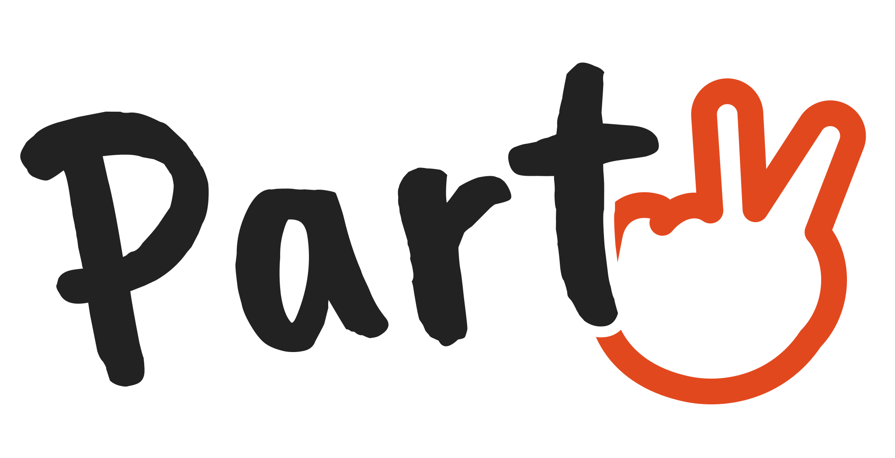

<p align="center"></p>

# Party – Fold & draw

*Fold and draw badly, together.*

Party is a phone game based on the old paper game *exquisite corpse*. In Swedish it is called *vikgubbar*. Players take turns drawing one part of a figure – head, body, legs – without seeing what the others drew. Only a few guide lines peek over the fold. Then the figure is unfolded on a stage with a drumroll, smoke and confetti. It gets a silly name and a home town, and if the host saves it, it ends up in a shared gallery.

It was built in a day and a bit for Äventyret's *Stupid hackathon* by group 7: Anna, Signe and Joel. The brief had two parts: build something completely unnecessary with AI, and make the assigned technology clearly visible. Ours was **Canvas – the user draws on the screen**. One house rule applied: the result must not become too useful.

## How to play

1. Press **Spela** on the welcome screen. The intro song starts and confetti fires. Then press **Ja, det är här det är party** to begin.
2. Pick **New game**, then where you play:
   - **In the room** – one phone is passed around.
   - **Online** – everyone on their own device. Start a **new online game** and wait for everyone, or **join a round** from the list of open games, where you can see who has already joined.
3. Choose the number of players (3–6, one part each), the direction (top to bottom or left to right), the turn order and a category:
   - **Free** – draw whatever you like.
   - **Adventurers** – the person drawing the head sees a colleague's face for five seconds, then draws it from memory. After the unfold, everyone else guesses who it is from up to six names before the figure's name is shown.
4. Draw your part. You see only the guide lines from the previous part. Fold, then pass the phone on or wait for the next player.
5. The host unfolds the figure on stage. It is named, and it lives in the city where you played. Online, it lives in the city nearest the midpoint between all players. The game asks for your location. Say no and your share of the figure lives on Easter Island.
6. The host chooses **Save**, with the name in the text field, or **Delete**. Online, the others wait and are then shown the figure, or told that it was deleted.
7. If someone leaves an online game mid-round, everyone is told. The host chooses to finish it among yourselves, wait for a new player to take over, or end the round.
8. Saved figures appear in the **Gallery**. You can filter them by continent, country and city, or see them on a map.

The interface is available in Swedish, English, French, Spanish and German.

## Running it

**Live:** The game runs on Heroku and redeploys automatically on every push to `main`. See [docs/heroku.md](docs/heroku.md).

**Locally:** You need Node 20 or newer.

```bash
npm install
PORT=5173 node server.js
```

Then open http://localhost:5173. Without a database the gallery lives in memory only. Without `ONLINE_PASSWORD` online play needs no password.

### Environment variables (Heroku config vars)

| Variable | What it does |
|---|---|
| `DATABASE_URL` | Set by the Heroku Postgres add-on. Without it the gallery is lost on every restart. |
| `ONLINE_PASSWORD` | Password for online play. **Never write it in the repo.** |
| `VAPID_PUBLIC_KEY`, `VAPID_PRIVATE_KEY`, `VAPID_SUBJECT` | Optional keys for push notifications. If they are missing, the server generates a new pair at each start. |

## How it is built

The game is plain HTML, CSS and JavaScript, with no framework and no build step. A small Node server without a framework serves the files and handles the shared parts: the gallery, online games and push notifications.

### Frontend

- **Canvas drawing.** `js/rita.js` handles drawing with Pointer Events, with `touch-action: none` so the page doesn't scroll while you draw. You get a palette, a brush size slider, an eraser, undo and clear.
- **Strokes are vectors.** Every stroke is stored as `{c: colour, w: width, p: [[x, y], …], e: eraser}`, never as a bitmap (`js/penndrag.js`). Vectors stay sharp at any size, they are small to send, and they let us add SVG export later.
- **The fold.** The last strip of each part is shown to the next player as guide lines (`js/kroppsdelar.js`, `js/rita.js`).
- **The stage.** `js/scen.js` handles the unfold: spotlights, folds that open one by one, and a background that adapts to whether the ink is dark or light. Smoke and confetti are drawn on a separate full-screen canvas (`js/effekter.js`). The drumroll and fanfare are synthesised with Web Audio (`js/ljud.js`). The intro song is an mp3 in `assets/ljud/`.
- **Cities.** `js/stader.js` is a hand-picked list of cities, all on land, so a figure never lives in the sea. It also works out the midpoint on the globe. `js/plats.js` asks the browser for the player's position and picks the nearest city.
- **Gallery.** `js/galleri.js` shows a grid with filters, plus a map view built with [Leaflet](https://leafletjs.com/) and OpenStreetMap tiles, loaded lazily from cdnjs.
- **Texts.** Every UI string lives in the dictionary `T` in `js/ordbok.js`, in all five languages.

The scripts share global variables and are loaded in a fixed order at the bottom of `index.html`. `start.js` is always last.

### Backend

| File | What it does |
|---|---|
| `server.js` | Serves only `index.html`, `css/`, `js/` and `assets/`. Handles gzip, range requests (Safari needs them for audio) and `no-cache` for code, so a deploy never mixes old and new files. Provides the gallery API (`/api/gallery`) with Postgres, or memory as a fallback, input validation and a limit of 40 new figures per IP per hour. |
| `online-server.js` | Online games in server memory: open lobbies, joining, turn order, who may see which strip, the reveal, the host's save or delete, and what happens when someone leaves mid-game (the host picks: the rest share the parts, wait for a new player, or end the round). Clients poll every two seconds. Players are identified by a random id and key sent in headers. Lobby players who go silent for 25 seconds are removed, and games are cleared after three hours. |
| `push-server.js` | Web Push through the `web-push` library. Notifications are sent when a game is full and when the figure is saved. This is needed for iPhones with the game in the background. |

Online games are lost when the server restarts, which happens on every deploy. The gallery is kept in Postgres and survives.

### AI

The prototype was first built as an artifact on claude.ai. There, `window.claude.use(...)` provided a database, sign-in, image uploads and an AI model that looks at the drawing and invents a name (`js/plattform.js`, `js/ai-namn.js`). Outside claude.ai, as on Heroku, the game falls back to nonsense syllable names such as "Bokri". A server-side AI endpoint, with the API key kept in an environment variable and never in client code, is planned but not built. See [docs/krav.md](docs/krav.md).

## Project layout

| Path | What |
|---|---|
| `index.html` | All screens of the game |
| `css/style.css` | All styling |
| `js/` | Code, one file per area. See the comment at the top of each file. |
| `assets/` | Logos, favicon, web manifest, intro sound, and `ansikten/` for Adventurer faces |
| `assets/ansikten/` | Face images (600 × 600 JPEG) and `ansikten.json`, which maps each first name to an image. See the README in that folder. |
| `server.js`, `online-server.js`, `push-server.js` | The Node server |
| `docs/` | Requirements, game rules, design guidelines, decisions, development plan, Heroku notes (all in Swedish) |
| `tools/logo-generator.py` | Generates the logos and the favicon. Don't edit the logo files by hand. |
| `CLAUDE.md` | Instructions for Claude Code (in Swedish) |

## For AI assistants

If you are an AI agent working in this repo, read [CLAUDE.md](CLAUDE.md) first. It is the binding instruction file. The short version:

- **The repo is public.** Never commit API keys, passwords, `.env` files or other secrets. Secrets belong in Heroku config vars.
- **Keep it framework-free.** Plain HTML, CSS and JS, with no build step. New script files go in the list at the bottom of `index.html`, before `start.js`.
- **No text without translations.** Every visible string goes in `T` in `js/ordbok.js`, in all five languages (sv, en, fr, es, de). Use the en dash (–), never the em dash.
- **Keep strokes as vectors.** Don't switch to storing bitmaps.
- **Logos come only from `tools/logo-generator.py`.**
- **Test on a phone-sized screen.** The target is Safari on iPhone.
- **Explain in simple Swedish.** The team are not all developers. Explain what you do and why.
- **Work in small steps.** Pull first, make small commits with messages in Swedish, and never throw away a teammate's changes when resolving conflicts.

## License

The code is released under the MIT License, see [LICENSE](LICENSE). The logo is based on the Caveat Brush typeface, licensed under the SIL Open Font License.
